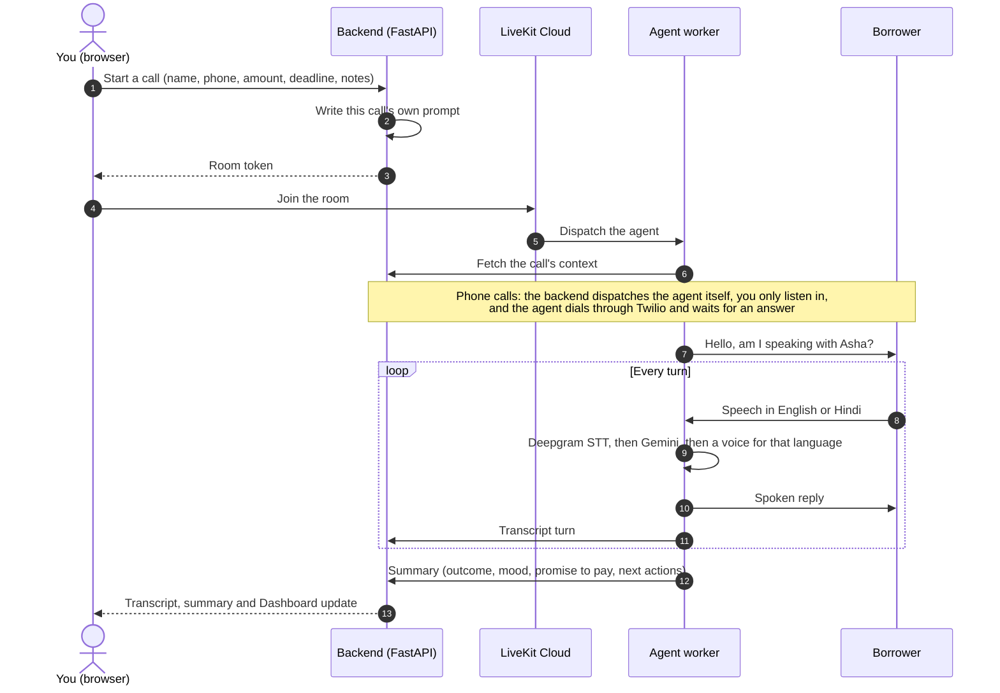

<div align="center">

# 🎙️ Alex

### AI Loan-Recovery voice agents that call, listen and follow up, in English and हिन्दी

*Create one agent, give it a name and a voice, and let it call borrowers. Every call ends with a live transcript and a structured summary.*


[What it does](#-what-it-does) · [How a call works](#-how-a-call-works) · [Pages](#-pages) · [Quick start](#-quick-start) · [API](#-api) · [Deployment](#%EF%B8%8F-deployment)

</div>

---

## ✨ What it does

| | |
|---|---|
| 🤖 **One agent per user** | A Loan-Recovery Agent with your chosen name and voice (Male or Female). |
| 📞 **Individual calls** | Give the client's name, phone, pending amount, payment deadline and notes. The agent opens with *"Hello, am I speaking with …?"* |
| 📋 **Bulk calls** | Upload a CSV; the agent works through it one person at a time, with pause, resume and cancel. |
| 🗣️ **English and Hindi** | The agent answers in the language the borrower last spoke, and switches the moment they do, with a matching voice. |
| 📅 **Holds the deadline** | Never agrees to a later date: notes it as the borrower's *request* and offers a callback from the lender's team. |
| 📝 **Live transcript and summary** | Every call gets a transcript and a summary: outcome, mood, promise to pay, whether a person is needed, next actions. |
| 📊 **Dashboard** | Today's calls, promise-to-pay rate, reply time and next actions, plus the last 7 days at a glance. |
| ☎️ **Real phone calls** | Through Twilio, built in and **off until set up** ([docs/phone-calls.md](docs/phone-calls.md)). |

## 📈 Status

| Phase | State |
|---|---|
| 1 Foundation | Done, verified (compose stack, migrations, tests) |
| 2 Core voice + Web UI | Working end to end (browser call, live transcript, post-call summary, chat titles) |
| 3–6 | Started |

> [!NOTE]
> Every reply's latency is recorded per turn (`call_turns.metrics_json`), and the Dashboard shows today's average.
> Speech-to-text takes about 0.4 s and the voice starts about 0.15–0.3 s after the text. Gemini's time to its first word
> dominates (about 2–9 s, depending on its load). The waits around each turn have since been shortened, and latency has
> not been re-measured since: the wait after the caller stops is now capped at 1.2 s, and the call loads and the voice
> warms up while the agent joins. The target is under 800 ms. Decisions are recorded in [`docs/adr/`](docs/adr).

## 🧠 How a call works



### Languages and voices

| | English replies | Hindi replies |
|---|---|---|
| **Male agent** | Deepgram Aura-2 `aura-2-draco-en` (British) | Cartesia `sonic-3` "Ayush" |
| **Female agent** | Deepgram Aura-2 `aura-2-pandora-en` (British) | Cartesia `sonic-3` Hinglish female voice |

- **Hearing:** Deepgram `nova-3` in `multi` mode with `en,hi` hints. Without the hints, *"ठीक है"* was once heard as Indonesian.
- **Thinking:** Gemini (`AGENT_LLM_MODEL`, default `gemini-3.5-flash-lite`). It writes Hindi in Devanagari, and in Hindi the agent speaks of itself in the masculine or feminine form to match its voice.
- **Choosing the voice:** the first letters of each reply decide it. Devanagari is voiced in Hindi through LiveKit Inference (billed to the LiveKit account); everything else is voiced in the agent's English voice.
- **Off by default:** a Gemini Live speech-to-speech mode (`AGENT_VOICE_MODE=realtime`) exists, but on this project's long prompt it dropped greetings and misheard noise.

### The agent's rules
Every agent shares one system prompt ([`collections_prompt.py`](backend/app/services/collections_prompt.py)); only its name and voice differ. Each call gets its own copy with that borrower's details and your notes. In short, the agent:

- **States what it is:** an AI assistant calling on behalf of the lender.
- **Verifies first:** it says nothing about a loan until the person confirms their name. A different name is never a confirmation.
- **Holds the deadline:** it never agrees to a later date and calls one a *request*. The only consequence it may state is one fixed sentence: *"Late charges will be added under your loan agreement."*
- **Is respectful:** it never threatens, shames or pressures, and never mentions legal action or contacting family or employers.
- **Puts hardship first:** job loss, illness, bereavement or an emergency gets empathy and a callback offer, not pressure.

## 🧭 Pages

**8 pages:** 2 public and 6 for signed-in users. Every signed-in page shares the left navbar. It has the **Alex** logo;
links to Dashboard, Your agent, Bulk calling, Profile and Settings; *Calls*, marked **Soon** (no call history page yet);
and, at the bottom, a card with your agent's name and whether it is Free or In a call.

| Route | Page | What it does |
|---|---|---|
| `/home` | `Landing.jsx` | 🌐 Public landing page (sections in `frontend/src/components/landing/`) |
| `/checkin` | `CheckinPage.jsx` | 🔐 Sign in or create an account: email and password, or Google when it is configured |
| `/dashboard/:uid` | `Dashboard.jsx` | 📊 Greeting and date, and a *Live · mm:ss · Return to call* pill during a call. Four figures for today: calls (vs yesterday), promise-to-pay rate, average reply time (2 s target) and calls needing a person. A 7-day bar chart. The 5 most recent calls (time, masked phone, amount, outcome, mood, length). Next actions from today's summaries, with tick-boxes saved on the server. A *Start a call* card. Search is marked **Soon** |
| `/agent/:uid` | `YourAgent.jsx` | 🤖 Create your agent (name and voice); its tile shows Free or In-Call. The details show its system prompt and voice, with Rename and Delete. **Call Agent** opens the **Individual Call** pop-up (client name, phone, pending amount, payment deadline, call context; once phone calls are set up, also *Call their phone* or *Try it in the browser*) or the **Bulk Call** pop-up (the CSV queue, with live progress, Pause, Resume and Cancel once phone calls are set up) |
| `/call/:uid` | `CallPage.jsx` | 🎧 The call in progress (no navbar link): the shape-shifting sphere, the live transcript, Mute and End call. For a phone call you listen in, with Calling, Ringing and On the phone. When the call ends, the summary opens on the right, with the reason if a phone call did not connect, plus *Call again* |
| `/bulk-calling/:uid` | `BulkCalling.jsx` | 📋 Upload a CSV of people to call. Every row is checked and previewed, and a sample file and the format are offered. The file becomes the Bulk Call queue |
| `/profile/:uid` | `ProfilePage.jsx` | 👤 Profile picture, username, email, number of agents, a weekly screen-time chart, Log out |
| `/settings/:uid` | `Settings.jsx` | 🎨 Dark or light theme, theme colour (presets or custom), font size and font family |

Any other address goes to `/home`. A signed-in page with someone else's `:uid` goes to your own Dashboard.

<details>
<summary><b>📋 Bulk Calling CSV format</b></summary>

Header row required. Column names ignore case and punctuation, and common aliases such as "Mobile Number", "Due Date"
and "Bank" are accepted.

- **Required:** `name`, `phone` (with country code), `amount_due`, `deadline`
- **Optional:** `lender`, `currency` (default INR), `loan_reference`, `notes`

Dates are ISO (`2026-12-05`) or day-first (`05/12/2026`). Up to 1 MB / 1,000 rows. The page offers a sample file.
</details>

> [!IMPORTANT]
> **Real phone calls** go LiveKit → Twilio Elastic SIP trunk → the borrower's phone. The agent speaks only once the person
> answers. A call that does not connect is recorded as busy, no answer, declined, invalid number or failed. Bulk calls go
> **one at a time**, and a number's full digits are kept only until its call ends. Everything stays **off until
> `SIP_OUTBOUND_TRUNK_ID` is set**, which needs an upgraded Twilio account and a voice number. Set it up with
> `cd backend && uv run python -m app.scripts.setup_phone_calls --country IN`; see [docs/phone-calls.md](docs/phone-calls.md).

## 🚀 Quick start

### Requirements

| Tool | Version | Needed for |
|---|---|---|
| Git | any recent | cloning |
| [uv](https://docs.astral.sh/uv/) | 0.13+ | Python envs and lockfiles (it fetches Python 3.12+ itself) |
| Python | 3.12+ (Docker images use 3.12; developed on 3.14) | backend and agent |
| Node.js + npm | 22 LTS or newer | frontend |
| Docker + Compose | 29.x | Postgres, Redis and the full containerised stack |
| `make` | any | shortcuts in the `Makefile` |
| `psql` (optional) | 16+ | inspecting the database |

<details>
<summary><b>🐧 Ubuntu / Debian</b></summary>

```bash
sudo apt update && sudo apt install -y git make curl postgresql-client
curl -LsSf https://astral.sh/uv/install.sh | sh                                  # uv
curl -o- https://raw.githubusercontent.com/nvm-sh/nvm/v0.40.1/install.sh | bash   # Node via nvm
source ~/.bashrc && nvm install 22
curl -fsSL https://get.docker.com | sudo sh                                       # Docker + Compose
sudo usermod -aG docker $USER                                                     # then log out and back in
```
</details>

<details>
<summary><b>🍎 macOS (Homebrew)</b></summary>

```bash
brew install git make uv node@22 libpq
brew install --cask docker          # Docker Desktop; open it once so the daemon starts
```
</details>

<details>
<summary><b>🪟 Windows</b></summary>

Use WSL2 and follow the Ubuntu steps inside it (`wsl --install -d Ubuntu`, then Docker Desktop with the WSL2 backend).
Native alternative:
```powershell
winget install Git.Git astral-sh.uv OpenJS.NodeJS.LTS Docker.DockerDesktop
```
`make` is not available natively on Windows: run the `Makefile` commands by hand, or use WSL.
</details>

Check everything is installed:
```bash
git --version && uv --version && node -v && npm -v && docker --version && docker compose version && make --version
```

### Install

```bash
git clone <your-repo-url> voice-agent-platform && cd voice-agent-platform

# 1. Python dependencies (backend/.venv and agent/.venv, from the lockfiles)
(cd backend && uv sync) && (cd agent && uv sync)

# 2. One-time download of the voice model weights (VAD + turn detector)
(cd agent && uv run python -m voice_agent.worker download-files)

# 3. Frontend dependencies
(cd frontend && npm ci)

# 4. Configuration: copy the template, generate the secrets, then add your keys
cp .env.example .env
sed -i "s|^INTERNAL_API_TOKEN=.*|INTERNAL_API_TOKEN=$(openssl rand -hex 24)|; s|^WORKSPACE_COOKIE_SECRET=.*|WORKSPACE_COOKIE_SECRET=$(openssl rand -hex 24)|; s|^AUTH_JWT_SECRET=.*|AUTH_JWT_SECRET=$(openssl rand -hex 32)|" .env
#    then edit .env: LIVEKIT_URL, LIVEKIT_API_KEY, LIVEKIT_API_SECRET, GEMINI_API_KEY, DEEPGRAM_API_KEY
ln -sf ../.env backend/.env && ln -sf ../.env agent/.env    # each service finds the shared .env

# 5. Postgres + Redis (Docker), then the database tables
make infra && (cd backend && uv run alembic upgrade head)   # migrations 0001–0008
```
On macOS use `sed -i ''` instead of `sed -i`.

### Run

| Option | How |
|---|---|
| 🐳 **Everything in containers** | `make up` → http://localhost:8080 (compose sets `BACKEND_INTERNAL_URL=http://backend:8000`) |
| 💻 **Local dev** | `make dev` (Postgres/Redis + migrations), then three terminals: `cd backend && uv run uvicorn app.main:create_app --factory --reload` · `cd agent && uv run python -m voice_agent.worker dev` · `cd frontend && npm run dev` → http://localhost:5173 |

> [!TIP]
> Give each copy of the project its own `AGENT_NAME` in `.env`. LiveKit shares calls between all workers that register
> with the same name on one LiveKit project, so another copy's worker could otherwise take your calls.

### Test

```bash
make test                                      # backend + agent (pytest)
make lint                                      # backend (ruff + mypy) + agent (ruff)
cd frontend && npm test -- --run && npm run lint
```

## ⚙️ Configuration

Keys live in `.env`, which is never committed; `.env.example` lists every setting.

| Service | Variable(s) | Used for |
|---|---|---|
| [LiveKit Cloud](https://cloud.livekit.io) | `LIVEKIT_URL`, `LIVEKIT_API_KEY`, `LIVEKIT_API_SECRET` | audio rooms, agent dispatch, noise cancellation, the Hindi voices (LiveKit Inference), phone calls (SIP) |
| [Google AI Studio (Gemini)](https://aistudio.google.com) | `GEMINI_API_KEY` | the agent's replies and the call summaries |
| [Deepgram](https://deepgram.com) | `DEEPGRAM_API_KEY` | speech-to-text and the English voices |
| [Twilio](https://www.twilio.com) *(optional)* | `TWILIO_ACCOUNT_SID`, `TWILIO_AUTH_TOKEN`, `TWILIO_PHONE_NUMBER` | real phone calls |
| *(secrets)* | `INTERNAL_API_TOKEN`, `WORKSPACE_COOKIE_SECRET`, `AUTH_JWT_SECRET` | random strings of 16+ characters, each different |

<details>
<summary><b>🎛️ Tuning knobs (all optional)</b></summary>

| Variable | Default | What it changes |
|---|---|---|
| `AGENT_LLM_MODEL`, `GEMINI_TEXT_MODEL`, `GEMINI_FALLBACK_MODELS` | `gemini-3.5-flash-lite`, … | Gemini models for replies and summaries (check which your key can use) |
| `AGENT_VOICE_MODE` | `pipeline` | `realtime` switches to Gemini Live (not recommended) |
| `STT_LANGUAGE` / `STT_LANGUAGE_HINTS` | `multi` / `en,hi` | the languages speech-to-text listens for |
| `HINDI_TTS_MODEL` | `cartesia/sonic-3` | the model behind the Hindi voices |
| `TTS_MODEL` | `aura-2-draco-en` | fallback voice for a call without one |
| `AGENT_IDLE_PROCESSES` | `1` in production | pre-warmed call processes; set `0` on a 1 GB host |
| `SIP_OUTBOUND_TRUNK_ID` | *(empty)* | switches real phone calls on |
| `AGENT_NAME` | `voice-agent` | the name the worker registers with LiveKit |
| `GOOGLE_CLIENT_ID`, `GOOGLE_CLIENT_SECRET` | *(empty)* | Google sign-in; add `${APP_ORIGIN}/api/v1/auth/google/callback` as a redirect URI |
</details>

## 🔌 API

All under `/api/v1`, with an httpOnly JWT cookie and `X-CSRF-Token` on writes. Passwords are hashed with argon2.

| Area | Endpoints |
|---|---|
| 🔐 Auth | `GET /auth/config` · `POST /auth/register` · `POST /auth/login` · `GET /auth/me` · `POST /auth/logout` · `GET /auth/google/start` · `GET /auth/google/callback` |
| 👤 User | `GET /users/{uid}` · `PUT\|GET /users/{uid}/avatar` · `GET /users/{uid}/screen-time` · `POST /users/{uid}/screen-time/heartbeat` |
| 🤖 Agent | `GET\|POST\|PUT\|DELETE /users/{uid}/agent` (create takes `name` and `voice`) |
| 📞 Calls | `POST /users/{uid}/collections/calls` (`borrower_name`, `phone`, `amount`, `due_date`, `context`, `mode`: `web` or `phone`) · `GET /calls/{id}` · `POST /calls/{id}/end` |
| 📋 Bulk calls | `POST /users/{uid}/bulk-calls/preview` · `POST /users/{uid}/bulk-calls` (raw CSV body) · `GET /users/{uid}/bulk-calls/current` · `POST /users/{uid}/bulk-calls/{job_id}/pause\|resume\|cancel` |
| 📊 Dashboard | `GET /users/{uid}/dashboard?tz=` · `PUT /users/{uid}/dashboard/next-actions/{call_id}/{index}` · `GET /users/{uid}/stats/calls-per-day?tz=` |

The agent worker talks to `/internal/calls/...` (context, turns, events, summary). These routes are protected by
`INTERNAL_API_TOKEN` and never exposed through the public proxy.

## ☁️ Deployment

The app runs on [Railway](https://railway.com) as four services built from `infra/docker/`:

```
            internet
                │
          ┌─────▼──────┐   private network   ┌──────────────┐        ┌──────────┐
          │  frontend  │ ── /api ──────────▶ │   backend    │ ─────▶ │ Postgres │
          │   (nginx)  │                     │  (FastAPI)   │        └──────────┘
          └────────────┘                     └──────▲───────┘
                                                    │ /internal
                                             ┌──────┴───────┐        ┌───────────────┐
                                             │    agent     │ ◀────▶ │ LiveKit Cloud │
                                             │   (worker)   │        └───────────────┘
                                             └──────────────┘
```

- Only the frontend is public. The backend runs the migrations on start and keeps profile pictures on a volume.
- Deploy a service from the repository root with `railway up --service <frontend|backend|agent>`.
- The Railway project is **not** connected to GitHub, so pushing does not deploy.
- The backend needs `ENV=prod`, `APP_ORIGIN`, `DATABASE_URL` (asyncpg form), `HOST=::`, `PORT=8000` and `FORWARDED_ALLOW_IPS=*`.
- The frontend needs `BACKEND_UPSTREAM`.
- On a 1 GB plan, set `AGENT_IDLE_PROCESSES=0` on the agent so that only one call process exists at a time.
- The agent worker keeps trying to reach LiveKit through internet outages for about a day before it gives up.

## 🗂️ Project map

```
├── agent/        LiveKit worker: one process per call
│   └── src/voice_agent/   worker.py · bilingual.py (Hindi/English voices) · telephony.py (phone dialing)
│                          providers/ (STT, LLM, TTS) · lifecycle/ (transcript, summary) · profile/
├── backend/      FastAPI API, Postgres, Alembic migrations 0001–0008
│   └── app/      api/ · services/ (prompt, calls, bulk queue, dashboard) · scripts/ (Twilio setup) · workers/
├── frontend/     React 18 + Redux Toolkit + Vite: pages/, components/, features/, lib/livekit/
├── contracts/    JSON schemas shared by backend and agent (agent profile, call summary) + summary prompt
├── infra/        Dockerfiles and the nginx template used on Railway
└── docs/         Architecture notes, decision records (adr/), phone-call runbook
```

<details>
<summary><b>🧰 Full dependency lists</b></summary>

**Backend** (`backend/`): `fastapi`, `uvicorn[standard]`, `sqlalchemy[asyncio]`, `asyncpg`, `alembic`, `pydantic-settings`,
`httpx`, `aiohttp`, `certifi`, `livekit-api`, `google-genai`, `jsonschema`, `argon2-cffi`, `pyjwt`, `email-validator`,
`itsdangerous`, `slowapi`, `prometheus-client`, `redis`. Dev: `pytest`, `pytest-asyncio`, `aiosqlite`, `ruff`, `mypy`,
`types-jsonschema`.

**Agent** (`agent/`): `livekit-agents` 1.8.x with `livekit-plugins-silero`, `-google`, `-deepgram`, `-turn-detector`,
`-noise-cancellation`, plus `livekit-api`, `httpx`, `jsonschema`, `pydantic`, `pydantic-settings`. Dev: `pytest`,
`pytest-asyncio`, `ruff`, `mypy`.

**Frontend** (`frontend/`, JavaScript): `react` 18, `react-dom`, `react-router-dom` 7, `@reduxjs/toolkit` 2,
`react-redux`, `livekit-client` 2, `three` + `@react-three/fiber` 8, `@fontsource-variable/geist`, `geist-mono`,
`open-sans`. Dev: `vite`, `@vitejs/plugin-react`, `vitest`, `jsdom`, `@testing-library/*`, `eslint`, `@eslint/js`,
`eslint-plugin-react-hooks`, `globals`, `prettier`, `@playwright/test`.

**Ports:** 5173 frontend dev · 8000 backend · 5443 dev Postgres · 6390 dev Redis (started by compose, not used by the
code yet) · 8080 frontend in the Docker stack.
</details>

<div align="center">

---

<sub>Built with LiveKit · Deepgram · Gemini · Cartesia · FastAPI · React</sub>

</div>
